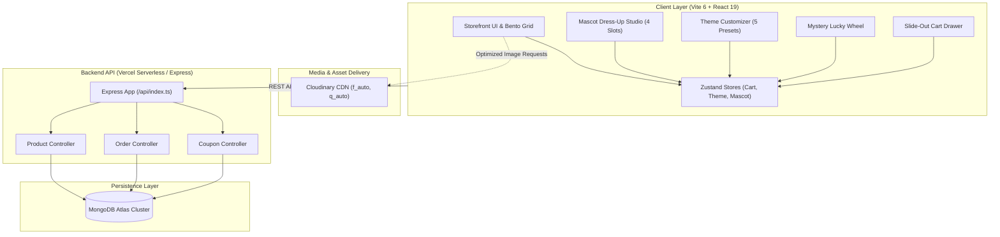

# FashionWekk — 3D Cartoon Pop-Art Streetwear & Gamified Full-Stack Atelier

<div align="center">


**A high-craft anime & cartoon streetwear e-commerce storefront powered by React 19, Vite, Express, MongoDB Atlas, Cloudinary CDN, GSAP micro-animations, and an interactive 4-slot Mascot Dress-Up Studio.**

[](https://fashion-wekk.vercel.app)
[](https://github.com/Khanhbroo/FashionWekk)
[](https://react.dev)
[](https://www.typescriptlang.org)
[](https://tailwindcss.com)
[](https://www.mongodb.com/atlas)
[](https://cloudinary.com)
[](https://vitest.dev)

</div>

---

## 🌐 Live Deployments & Repository Links

* 🚀 **Vercel Production Deployment**: [https://fashion-wekk.vercel.app](https://fashion-wekk.vercel.app) *(Alternate mirror: [https://fashionwekk.vercel.app](https://fashionwekk.vercel.app))*
* 📦 **GitHub Repository**: [https://github.com/Khanhbroo/FashionWekk](https://github.com/Khanhbroo/FashionWekk)
* 📡 **Healthcheck Endpoint**: `https://fashion-wekk.vercel.app/api/health`

---

## ⚡ Key Highlights & Core Features

### 1. 🕹️ Atelier Mascot Dress-Up Studio
* **4-Slot Equipment Mechanics**: Equip customized anime streetwear directly onto the mascot avatar across `Top` (hoodies, tees), `Bottom` (cargos, shorts), `Headwear` (beanies, caps, masks), and `Accessories` (art toys, hologram orbs, skate decks).
* **Live Dynamic Canvas Rendering**: Multi-layered compositing with smooth CSS spring transitions and instant equip/unequip toggles.
* **Persistent Wardrobe State**: Powered by Zustand state store with `localStorage` persistence and cross-component reactivity.
* **Smart Catalog Inference**: Automatic mapping of product categories into valid mascot slots with fallback badges.

### 2. 🎨 Y2K Real-Time Theme Customizer
* **5 Curated Gradient Presets**:
  * 🌌 **Y2K Cyber Sky**: Classic Ethereal Cloud Horizon
  * ⚡ **Acid Volt**: High-Voltage Neon Street Rave
  * 🪞 **Liquid Chrome**: Cybernetic Mercury & Minimalist Platinum
  * 🌇 **Sunset Harajuku**: Pop-Art Tokyo Golden Hour
  * 🌑 **Onyx Nocturne**: Deep Steetwear Stealth & Dark Charcoal
* **Instant Mode Switching**: Light & Dark mode support with dynamic CSS variables injected into `:root` and zero-refresh updates.

### 3. ☁️ Cloudinary Image Optimization Pipeline
* **High-Speed CDN Delivery**: Custom `getOptimizedImageUrl` utility dynamically injects width parameters (`w_500`, `w_800`), auto-compression (`q_auto:good`), and modern formats (WebP/AVIF).
* **Automated Asset Sync**: Standalone batch synchronization scripts (`server/scripts/syncBatchToCloudinary.cjs`) and catalog manifest (`server/data/cloudinary_catalog.json`).

### 4. 🎰 Gamification Lucky Mystery Wheel
* **Interactive Canvas Confetti**: Physical spin inertia with deceleration curves and confetti burst upon winning.
* **Procedural Sound FX**: Web Audio API sound synthesis providing authentic mechanical clicks and celebratory audio fanfares.
* **Live Coupon Vault**: Win promo codes (`FASHION20`, `DRIP50`, `LUCKY30`) with one-click copy to clipboard and auto-application at checkout.

### 5. 🛍️ High-Conversion E-Commerce Pipeline
* **Slide-out Cart Drawer**: Real-time subtotal calculations, dynamic free-shipping progress indicator, item quantity modifiers, and coupon discount deduction.
* **Product Quick-View Modal**: Instant previews with GSM fabric weight indicators, high-res image zoom, size selectors, and instant "Add to Bag".
* **Rich Product Detail Pages**: Full product showcases with high-res galleries, material specs, model sizes, and related recommendations.

### 6. 🎛️ MongoDB Atlas Command Center (`/admin`)
* **Real-time Inventory Management**: Live inventory tracking, stock adjustments, and instant stock status indicators.
* **Cloudinary Media Previews**: Live visual previews of uploaded garments and accessories directly inside the admin table.

---

## 🏗️ System Architecture



---

## 📁 Repository Structure

```text
FashionWekk/
├── api/                        # Vercel serverless entrypoint
│   └── index.ts                # Express serverless handler & route dispatcher
├── docs/                       # Project specifications and architecture
│   └── toon_drip_master_specification.md # Master atelier specification
├── public/                     # Static assets, fallback media, and icons
│   └── assets/images/          # High-resolution cartoon streetwear visuals
├── server/                     # Express API & MongoDB backend
│   ├── config/db.ts            # Mongoose Atlas connection with connection cache
│   ├── controllers/            # Product, Order, and Coupon controllers
│   ├── data/                   # Cloudinary asset catalog manifests
│   ├── models/                 # Mongoose schemas (Product, Order, Coupon)
│   ├── routes/                 # Express API routes
│   ├── scripts/                # Cloudinary batch upload & sync utilities
│   ├── seeder.ts               # Database seeder populating ~100 products
│   └── index.ts                # Local Express development server
├── src/                        # Frontend application (React 19 + TypeScript)
│   ├── components/             # Common & layout components
│   │   ├── common/             # ThemeCustomizerModal, buttons, modals
│   │   └── layout/             # Navbar, HeroSection, FlashSaleBanner, Footer
│   ├── features/               # Feature-driven modular architecture
│   │   ├── admin/              # Atlas command center & inventory management
│   │   ├── cart/               # CartDrawer & CouponAppliedModal
│   │   ├── collections/        # Capsule collections & lookbook banners
│   │   ├── gamification/       # MysteryWheelModal & confetti engine
│   │   ├── mascot/             # MascotDressUpDrawer, MascotAvatar & slot taxonomy
│   │   └── products/           # ProductCard, ProductList, DetailPage, Filter
│   ├── stores/                 # Zustand state stores (themeStore, cartStore)
│   ├── types/                  # Shared TypeScript interfaces & types
│   ├── utils/                  # Image optimizer, audio synthesizer, formatters
│   ├── App.tsx                 # Root application wrapper & router
│   ├── index.css               # Tailwind CSS v4 design tokens & theme classes
│   └── main.tsx                # Client DOM entrypoint
├── tests/                      # Automated test suite (Vitest)
│   ├── cart.test.ts            # Shopping bag calculations & persistence
│   ├── coupon.test.ts          # Coupon discount rules & expiry checks
│   ├── imageOptimizer.test.ts  # Cloudinary URL transform tests
│   ├── mascot.test.ts          # 4-slot dress-up mechanics & slot taxonomy
│   ├── navigation_collection.test.ts # Lookbook routes & collection filters
│   └── stock_order.test.ts     # Stock constraints & order processing
├── package.json                # Project dependencies & scripts
├── tsconfig.json               # TypeScript strict configuration
├── vercel.json                 # Vercel deployment rewrites & build configuration
└── vite.config.ts              # Vite 6 configuration & chunking
```

---

## 🧪 Automated Test Suite (Vitest)

FashionWekk enforces Test-Driven Development (TDD) across all business logic:

```bash
npm test
```

```text
 ✓ tests/cart.test.ts (5 tests)
 ✓ tests/stock_order.test.ts (4 tests)
 ✓ tests/coupon.test.ts (7 tests)
 ✓ tests/imageOptimizer.test.ts (5 tests)
 ✓ tests/mascot.test.ts (11 tests)
 ✓ tests/navigation_collection.test.ts (4 tests)

 Test Files  6 passed (6)
      Tests  36 passed (36)
```

---

## 🛠️ Local Development Setup

### 1. Prerequisites
* **Node.js**: v18.0.0 or higher
* **npm**: v9.0.0 or higher
* **MongoDB**: A free MongoDB Atlas cluster connection string

### 2. Clone & Install
```bash
git clone https://github.com/Khanhbroo/FashionWekk.git
cd FashionWekk
npm install
```

### 3. Environment Configuration
Create a `.env` file in the root directory:

```env
PORT=5000
MONGODB_URI=mongodb+srv://<username>:<password>@<cluster>.mongodb.net/fashionwekk?retryWrites=true&w=majority
VITE_API_URL=http://localhost:5000/api
CLOUDINARY_CLOUD_NAME=dptpb60p7
CLOUDINARY_API_KEY=your_key_here
CLOUDINARY_API_SECRET=your_secret_here
```

### 4. Seed the Database
Populate MongoDB Atlas with ~100 cartoon streetwear items:
```bash
npm run seed
```

### 5. Launch Development Server
```bash
npm run dev
```
* **Frontend**: `http://localhost:5173`
* **Backend API**: `http://localhost:5000/api`
* **Admin Dashboard**: `http://localhost:5173/#admin`

---

## 🚀 Deployment (Vercel Serverless)

The project includes zero-config serverless support via `vercel.json` and `api/index.ts`:

1. Import the repository into [Vercel](https://vercel.com/new).
2. Configure **Environment Variables**:
   * `MONGODB_URI`: Your MongoDB Atlas connection URI.
   * `CLOUDINARY_CLOUD_NAME`: `dptpb60p7` (or your cloud name).
3. Set **Framework Preset**: `Vite`.
4. Deploy! Vercel routes `/api/*` to the serverless Express function and all static routes to the Vite single-page application.

---

## 📄 License & Attribution

Designed and developed with high-craft by **KhanhBro** for **FashionWekk Atelier**.
All rights reserved © 2026.
