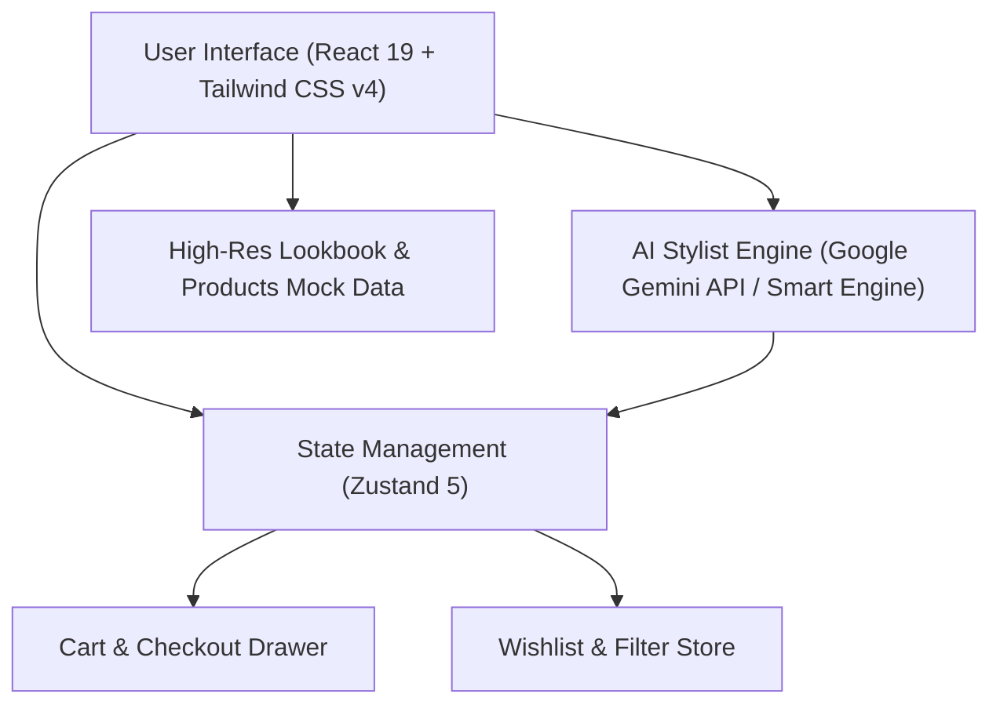

# Kế Hoạch Triển Khai Dự Án: AURA — Minimalist Fashion E-Commerce & AI Stylist

> [!NOTE]
> Mục tiêu dự án: Xây dựng một ứng dụng web thương mại điện tử thời trang cao cấp từ đầu, có giao diện chuẩn chỉnh như các thương hiệu quốc tế (Zara, Acne Studios, Fear of God), tích hợp **Trợ lý phối đồ AI (AI Fashion Stylist)** để biến dự án thành "thỏi nam châm" thu hút khách hàng trên Upwork & nhà tuyển dụng.

---

## 1. Định Vị & Phong Cách Thiết Kế (Concept & Brand Identity)

* **Tên thương hiệu:** **AURA Apparel / Noir Studio**
* **Phong cách (Vibe):** Minimalist Luxury & Modern Streetwear. Tone màu đen/trắng/xám tro (monochrome) kết hợp font chữ hiện đại, hình ảnh lookbook thời trang sắc nét.
* **Điểm nhấn đặc biệt (Differentiator):** Không chỉ là web bán hàng thông thường, web có tính năng **"AI Personal Stylist"** — khách nhập dịp đi chơi (ví dụ: *đi date tối, đi phỏng vấn, đi cà phê mùa thu*), AI sẽ tự động phân tích và phối ra nguyên set đồ kèm 1 nút bấm *"Thêm cả set vào giỏ hàng"*.

---

## 2. Kiến Trúc Kỹ Thuật (Tech Stack)

* **Core Framework:** `React 19` + `TypeScript` + `Vite 8` (chuẩn công nghệ mới nhất như trong các repo đỉnh của anh).
* **Styling:** `Tailwind CSS v4` (tận dụng engine v4 mới nhất với responsive mượt mà).
* **State Management:** `Zustand 5` (quản lý giỏ hàng Cart Drawer, Wishlist, bộ lọc sản phẩm, chuyển đổi tiền tệ USD/VND).
* **UI Icons & FX:** `Lucide React` + `Canvas Confetti` (hiệu ứng pháo hoa khi bấm đặt hàng thành công).
* **AI Integration:** Google Gemini API (hoặc chế độ Local AI Fallback nếu chưa nhập API Key).

---

## 3. Các Tính Năng Cốt Lõi (Core Features)

### 3.1. Trang Chủ & Bộ Sưu Tập (Storefront & Catalog)
* **Header thông minh:** Thanh điều hướng dính (Sticky Header), thanh tìm kiếm nhanh, nút đổi tiền tệ (\$ USD / ₫ VNĐ), icon Yêu thích & Giỏ hàng có huy hiệu số lượng động.
* **Hero Editorial Lookbook:** Banner thời trang toàn màn hình với animation chuyển đổi, typography ấn tượng và nút CTA *"Explore Collection"*.
* **Bộ lọc đa chiều (Smart Filters):** Lọc theo danh mục (*Hoodies, Boxy Tees, Cargo Pants, Jackets, Accessories*), lọc theo size (*S, M, L, XL*), lọc theo khoảng giá và sắp xếp (*Mới nhất, Giá tăng/giảm*).

### 3.2. Chi Tiết Sản Phẩm & Giỏ Hàng (Product Detail & Cart Drawer)
* **Product Card:** Hiệu ứng hover zoom ảnh người mẫu, gắn tag *"New Arrival"*, *"Best Seller"*, xem nhanh (Quick View), chọn bảng màu (Color Swatches).
* **Modal xem chi tiết:** Bộ sưu tập ảnh góc chụp, bảng chọn size, tình trạng tồn kho (Stock indicator), nút thêm vào giỏ có thông báo Toast.
* **Slide-out Cart Drawer:** Ngăn kéo trượt từ cạnh phải màn hình hiển thị danh sách món đồ, tăng giảm số lượng, thanh tiến độ *"Freeship"*, nhập mã giảm giá (`AURA2026`), và nút giả lập Checkout kèm màn hình chúc mừng.

### 3.3. 🌟 Tính Năng Đắt Giá: "AI Personal Stylist" (Trợ Lý Phối Đồ)
* Một nút nổi hoặc banner tương tác: *"Ask AI Stylist — Bạn muốn mặc gì hôm nay?"*.
* Người dùng có thể:
  1. Gõ tự do: *"Phối cho mình một outfit đi dạo phố mùa đông vừa ấm vừa chất"*
  2. Hoặc bấm chọn nhanh các tag sự kiện: `Night Out`, `Minimalist Office`, `Weekend Vibe`, `Casual Streetwear`.
* **Phản hồi của AI:** Đưa ra lời khuyên thời trang ngắn gọn, chọn sẵn combo 3 món phù hợp trong kho (ví dụ: Áo khoác da + Áo thun oversized + Quần ống rộng) và cung cấp nút: **`Thêm cả set này vào giỏ hàng ($185)`**.

---

## 4. Lộ Trình Triển Khai (Roadmap Từng Bước)

| Giai đoạn | Nội dung công việc | Kết quả đầu ra |
| :--- | :--- | :--- |
| **Giai đoạn 1** | Cài đặt Tailwind CSS v4, Lucide Icons, Zustand và cấu trúc thư mục chuẩn component/store/types | Dự án sẵn sàng dev, 0 lỗi build |
| **Giai đoạn 2** | Xây dựng kho dữ liệu sản phẩm (Mock Data phong phú với ảnh lookbook chất lượng cao) | Danh mục 12+ sản phẩm đa dạng |
| **Giai đoạn 3** | Lập trình Navbar, Hero Banner, Product Grid, Quick View Modal | Giao diện storefront hoàn chỉnh |
| **Giai đoạn 4** | Lập trình Cart Drawer (Slide-out), Wishlist, bộ lọc kích thước/màu sắc với Zustand | Luồng mua hàng mượt mà 100% |
| **Giai đoạn 5** | Tích hợp Module **AI Fashion Stylist** (kết nối Gemini API / Smart Stylist logic) | Tính năng AI thông minh tạo điểm nhấn |
| **Giai đoạn 6** | Kiểm thử build production (`npm run build`), tối ưu responsive trên mobile/desktop | Sẵn sàng deploy lên Vercel & gắn Portfolio |
