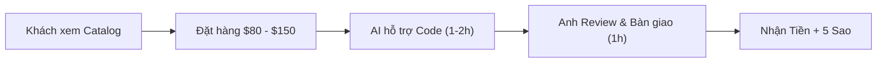

# Cẩm Nang Tối Ưu Upwork & Chiến Lược AI-Assisted Freelancer (4–6h/Tuần)

> [!NOTE] 
> Bản kế hoạch và tài liệu tham khảo nhanh dành riêng cho **Doan Quoc Khanh** — Fullstack Developer (HUST CS, IELTS 6.5, 2–3 năm kinh nghiệm thực chiến).

---

## 1. Bản Mẫu Hồ Sơ Upwork Chuẩn (Profile Master Blueprint)

### 1.1. Tiêu Đề Profile (Title)
```text
Full-Stack Developer | React & Next.js | Node.js | TypeScript
```

### 1.2. Mức Giá (Hourly Rate) & Thời Gian (Availability)
* **Hourly Rate:** `$24.00 / hr` (hoặc `$25.00 / hr`).
* **Availability:** `Less than 30 hrs/week` (để khách không yêu cầu online giờ hành chính).

### 1.3. Phần Giới Thiệu (Overview / Introduction)
```markdown
Are you looking for a clean, fast, and scalable web application built with modern React & Next.js? I help startups and businesses transform Figma designs into production-ready frontends and build reliable Node.js backends.

With a Computer Science degree from Hanoi University of Science and Technology (HUST) and 2+ years of hands-on fullstack development experience, I bridge UI/UX fidelity with robust backend architectures.

What I bring to your project:
• Frontend: React.js, Next.js (App Router, Server Actions), TypeScript, Tailwind CSS, Redux Toolkit.
• Backend & APIs: Node.js, Express.js, RESTful APIs, JWT Auth, Role-Based Access Control (RBAC).
• Databases: PostgreSQL, MongoDB, Prisma/Mongoose.
• Integrations: Web3 (MetaMask/Web3.js), Third-party APIs, Headless CMS, Payment Gateways.
• Code Quality: Clean modular architecture, responsive mobile-first design, SEO optimization, and on-time delivery.

Why work with me:
✔ Pixel-perfect execution from Figma/UI designs.
✔ Fluent English communication (IELTS 6.5) — seamless async updates and clear requirement discussions.
✔ Production experience building real enterprise CMS, dashboards, and internal platforms.

Let’s turn your idea into a high-performing product. Feel free to send me a message with your project details or Figma link to get started!
```

---

## 2. Lịch Sử Công Việc (Employment History - Chuẩn Dưới 1,000 Ký Tự)

### Vị trí 1: Tapita Technology Joint Stock Company (01/2026 – Present)
* **Title:** Fullstack Developer
* **Description:**
```text
Full-stack Developer responsible for end-to-end development of internal enterprise platforms and web applications.

Key Responsibilities & Achievements:
• Architected scalable database schemas using PostgreSQL and MongoDB for core user and CMS modules.
• Engineered secure RESTful APIs with JWT authentication and role-based access control (RBAC).
• Developed responsive, pixel-perfect frontends from Figma designs using React, Next.js, and Tailwind CSS.
• Optimized API endpoints and component architecture, improving response time and development speed.

Tech Stack: React, Next.js, Node.js, Express, PostgreSQL, MongoDB, TypeScript, Tailwind CSS.
```

### Vị trí 2: TOILA AI Education Joint Stock Company (01/2024 – 12/2025)
* **Title:** Fullstack Developer
* **Description:**
```text
Contributed directly to the core engineering of flagship enterprise platforms: WhoIsMe Platform and ToilaAI CMS.

Key Contributions & Achievements:
• Designed scalable database schemas using MongoDB and PostgreSQL for User, Journal, and CMS Content modules.
• Engineered secure RESTful CRUD APIs, auth flows, and role-based access control (RBAC).
• Converted complex Figma UI/UX designs into pixel-perfect, responsive React/Next.js interfaces.
• Collaborated closely within an Agile squad of 10 to ensure continuous on-time sprint deliveries.

Tech Stack: React, Next.js, Node.js, Express, MongoDB, PostgreSQL, Tailwind CSS.
```

### Vị trí 3: MindX Technology School Joint Stock Company (10/2022 – 12/2025)
* **Title:** Programming Instructor
* **Description:**
```text
Delivered project-based programming courses focusing on core web technologies, software architecture, and practical engineering skills.

Key Responsibilities & Impact:
• Instructed modern web development (HTML5, CSS3, JavaScript ES6+), guiding learners through building real-world projects.
• Cultivated debugging methods, problem-solving mindset, and clean coding practices.
• Mentored multiple student teams through the complete product lifecycle: from ideation and UI implementation to deployment.
• Successfully trained and mentored 100+ students to build and deploy their own web applications.
```

---

## 3. Chiến Lược 0đ Vốn: Project Catalog Đóng Gói

> [!TIP]
> Tạo Project Catalog **hoàn toàn miễn phí (0 Connects)** để khách hàng tự đặt mua trực tiếp.



* **Gói 1: Figma to Next.js / Tailwind**
  * *Tiêu đề:* Convert Figma design into responsive Next.js 14 & Tailwind CSS
  * *Giá:* $80 – $120 | *Thời gian giao:* 2 ngày.
* **Gói 2: API & Database Development**
  * *Tiêu đề:* Build secure RESTful APIs with Node.js, Express, and PostgreSQL
  * *Giá:* $100 – $150 | *Thời gian giao:* 2 ngày.
* **Gói 3: AI Feature Integration**
  * *Tiêu đề:* Integrate OpenAI / Claude AI Assistant into your Web App
  * *Giá:* $150 – $200 | *Thời gian giao:* 2 ngày.

---

## 4. Kịch Bản Prompt AI Hỗ Trợ Đấu Thầu (Proposal Template)

Khi gửi đề xuất công việc, sử dụng template ngắn gọn, đánh trúng điểm đau (pain point) của khách:

```text
Hi [Client Name],

I noticed you're looking to [Client's goal: e.g., convert your Figma design to Next.js / fix the Node.js API issue]. 

As a Fullstack Developer with extensive experience in React/Next.js and Node.js (and Computer Science background from HUST), I can get this completed cleanly and quickly for you:
1. [Specific step 1: e.g., Set up clean modular Tailwind components matching pixel-perfect Figma specs]
2. [Specific step 2: e.g., Implement responsive mobile-first views and verify fast Lighthouse load speed]
3. [Specific step 3: e.g., Provide ready-to-deploy code with clean documentation]

Here is a quick live project demo with similar stack: [Link Vercel / Portfolio]

I have availability this week and can start right away. Would you be open to a quick message chat or sharing the repo/Figma link?

Best regards,
Khanh Doan
```
